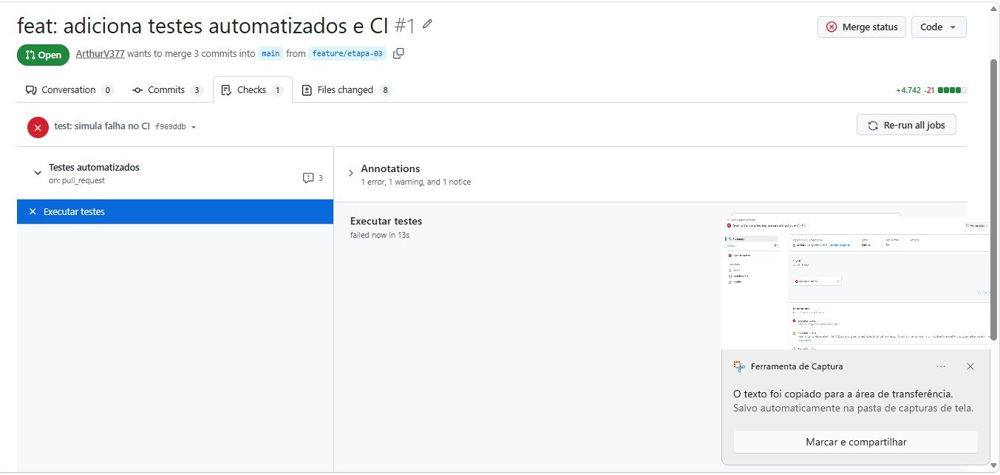
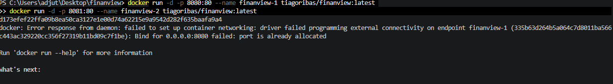

# FinanView — Conversor de Moedas

**Repositório:** https://github.com/ArthurV377/finanview

---

## 1. Integrantes do Grupo

| Nome | Matrícula | GitHub | Responsabilidade | Principal PR |
|---|---|---|---|---|
|Cláudio Macedo Gama Filho | 22603506 | [claudiomacedo74] | Front-end e acessibilidade | [PR #4](https://github.com/ArthurV377/finanview/pull/4) |
| Integrante 2 | XXXXXX | @usuario2 | Conversão de moedas e Supabase | [PR #2](https://github.com/ArthurV377/finanview/pull/2) |
| Arthur Valério Cavalcante Costa | 22612204 | ArthurV377 | Testes automatizados e CI | [PR #1](https://github.com/ArthurV377/finanview/pull/1) |
| Tiago | 22606645 | [@TiagoRibas1] | Docker e documentação | [PR #4](https://github.com/ArthurV377/finanview/pull/4) |

---

## 2. Sobre o Projeto

O FinanView é uma aplicação web que permite consultar cotações e converter moedas em tempo real. Também conta com uma opção para salvar moedas favoritas e facilitar o acesso às cotações.

**API utilizada**

O projeto utiliza a [Frankfurter API](https://www.frankfurter.dev/), que fornece informações sobre taxas de câmbio e permite realizar conversões sem precisar de uma chave de acesso.

**Banco de dados**

Utilizamos o [Supabase](https://supabase.com/), baseado em PostgreSQL, para salvar e consultar as moedas favoritas dos usuários.

---

## 3. Como Executar o Projeto

### Execução local

1. Clone o repositório:

```bash
git clone https://github.com/ArthurV377/finanview.git
```

2. Entre na pasta do projeto:

```bash
cd finanview
```

3. Abra o arquivo `index.html` utilizando uma extensão como Live Server no VS Code ou outro servidor local.

### Execução com Docker

**Imagem no Docker Hub:** https://hub.docker.com/r/tiagoribas/finanview

Para baixar e executar o projeto diretamente pelo Docker, utilize:

```bash
docker run -d -p 8080:80 --name finanview tiagoribas/finanview:latest
```

Depois, abra o navegador e acesse:

http://localhost:8080

---

## 4. Como Executar os Testes

Para rodar os testes automatizados do projeto, siga os passos:

1. Instale as dependências:

```bash
npm install
```

2. Execute os testes:

```bash
npm test
```

---

## 5. Evidências e Integração

### PR bloqueada pelo CI

Imagem mostrando uma Pull Request bloqueada após a execução das verificações do GitHub Actions.



### Containers em execução

Registro dos containers ativos utilizando o comando `docker ps`.



### Conflito de merge resolvido

Durante a integração das branches com a branch principal `main`, tivemos um conflito no arquivo `index.html`.

O problema aconteceu na parte em que a estrutura principal da página se encontrava com o rodapé. Para resolver, analisamos as alterações no VS Code e ajustamos o código manualmente, mantendo os elementos necessários e removendo as duplicações.

Depois disso, o conflito foi resolvido e o merge pôde ser concluído normalmente.
