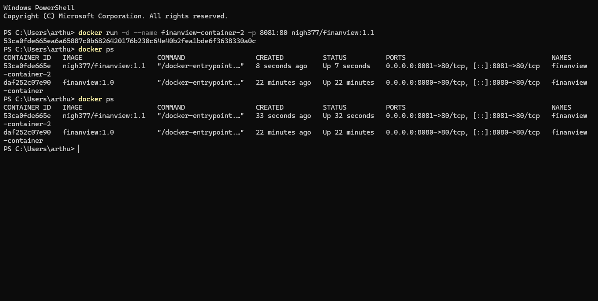

# FinanView — Conversor de Moedas

Aplicação web para conversão de moedas utilizando a API Frankfurter, com persistência de moedas favoritas em banco de dados e execução em container Docker.

## Links do projeto

- **Aplicação no GitHub Pages:** [https://arthurv377.github.io/finanview/](https://arthurv377.github.io/finanview/)
- **Repositório GitHub:** [https://github.com/ArthurV377/finanview](https://github.com/ArthurV377/finanview)
- **Imagem no Docker Hub:** [https://hub.docker.com/r/nigh377/finanview](https://hub.docker.com/r/nigh377/finanview)

## Tecnologias utilizadas

- HTML5
- CSS3
- JavaScript
- Frankfurter API
- Supabase (PostgreSQL)
- Docker
- Nginx
- Git e GitHub Pages

## Funcionalidades

- Conversão entre moedas utilizando a API Frankfurter.
- Seleção das moedas de origem e destino.
- Inversão das moedas selecionadas.
- Cadastro, listagem e exclusão de moedas favoritas.
- Persistência dos favoritos em banco de dados.
- Interface responsiva para diferentes tamanhos de tela.
- Navegação por teclado com indicação visual de foco nos botões.

## Persistência de dados

O projeto utiliza o Supabase, serviço baseado em PostgreSQL, para armazenar as moedas favoritas.

### Tabela `favoritos_moedas`

| Campo | Tipo | Descrição |
|---|---|---|
| `id` | BIGINT | Identificador único gerado automaticamente |
| `criado_em` | TIMESTAMPTZ | Data e hora do cadastro |
| `codigo` | TEXT | Código da moeda, como EUR ou USD |
| `nome` | TEXT | Nome da moeda |

O campo `codigo` possui uma restrição de unicidade para impedir que a mesma moeda seja cadastrada mais de uma vez.

A aplicação permite criar, listar e excluir registros. Como os dados ficam no banco de dados, os favoritos continuam disponíveis após atualizar ou fechar o navegador.

### Limitação de segurança conhecida

Nesta versão demonstrativa, as políticas de Row Level Security (RLS) permitem operações de leitura, inserção e exclusão para usuários anônimos. Assim, os favoritos não são privados por usuário: quem acessar a aplicação poderá visualizar ou alterar a lista compartilhada.

A aplicação utiliza a chave pública do Supabase no frontend. Chaves secretas ou `service_role` não devem ser expostas no navegador.

## Execução local

É possível abrir o `index.html` no navegador ou utilizar a extensão Live Server do VS Code. Para testar a aplicação conteinerizada, utilize as instruções a seguir.

## Docker

A aplicação é servida pelo Nginx dentro de um container.

### Executar a imagem publicada

```bash
docker run -d -p 8080:80 --name finanview nigh377/finanview:1.1
```

Depois, acesse [http://localhost:8080](http://localhost:8080).

Se a porta 8080 ou o nome `finanview` já estiver em uso, escolha outra porta ou nome para o container.

### Construir a imagem localmente

Na raiz do projeto, execute:

```bash
docker build -t finanview:1.1 .
```

Depois, inicie o container:

```bash
docker run -d -p 8082:80 --name finanview-local finanview:1.1
```

Acesse [http://localhost:8082](http://localhost:8082).

### Docker Hub

Imagem publicada: [https://hub.docker.com/r/nigh377/finanview](https://hub.docker.com/r/nigh377/finanview)

Tags publicadas:

- `nigh377/finanview:1.0`
- `nigh377/finanview:1.1`
- `nigh377/finanview:latest`

## SQ1 — Arquivo `.dockerignore`

O arquivo `.dockerignore` exclui arquivos desnecessários, como metadados do Git, configurações locais e rascunhos, do contexto enviado ao Docker durante o build. Isso evita incluir conteúdo irrelevante e pode reduzir o tamanho do contexto e o tempo de construção da imagem.

## SQ2 — Versionamento de imagens

A versão `1.0` corresponde à primeira imagem funcional publicada. A versão `1.1` inclui uma melhoria na interface da lista de moedas favoritas. A tag `latest` foi atualizada para apontar para a versão mais recente publicada (`1.1`).

As três tags estão disponíveis no [Docker Hub](https://hub.docker.com/r/nigh377/finanview).

## SQ3 — Descrição do Docker Hub

O Overview do repositório no Docker Hub foi configurado com uma descrição do FinanView, suas tecnologias, um comando para executar a aplicação e o link para o repositório no GitHub.

- **Docker Hub:** [https://hub.docker.com/r/nigh377/finanview](https://hub.docker.com/r/nigh377/finanview)
- **GitHub:** [https://github.com/ArthurV377/finanview](https://github.com/ArthurV377/finanview)

Comando de execução:

```bash
docker run -d -p 8080:80 --name finanview nigh377/finanview:1.1
```

## SQ4 — Execução de dois containers

Evidência do comando `docker ps` mostrando dois containers da aplicação em execução nas portas 8080 e 8081:



### Como gerenciaria 100 containers?

Se a aplicação precisasse executar 100 containers, utilizaria uma plataforma de orquestração como Kubernetes. Um cluster reúne os recursos que executam e gerenciam as aplicações. Os Pods são as menores unidades implantáveis do Kubernetes e podem conter um ou mais containers. As réplicas permitem manter múltiplas instâncias da aplicação, enquanto o controlador apropriado ajuda a manter a quantidade desejada, substituir instâncias que falham e distribuir a carga conforme a configuração.

## Autor

Arthur Valério Cavalcante Costa
